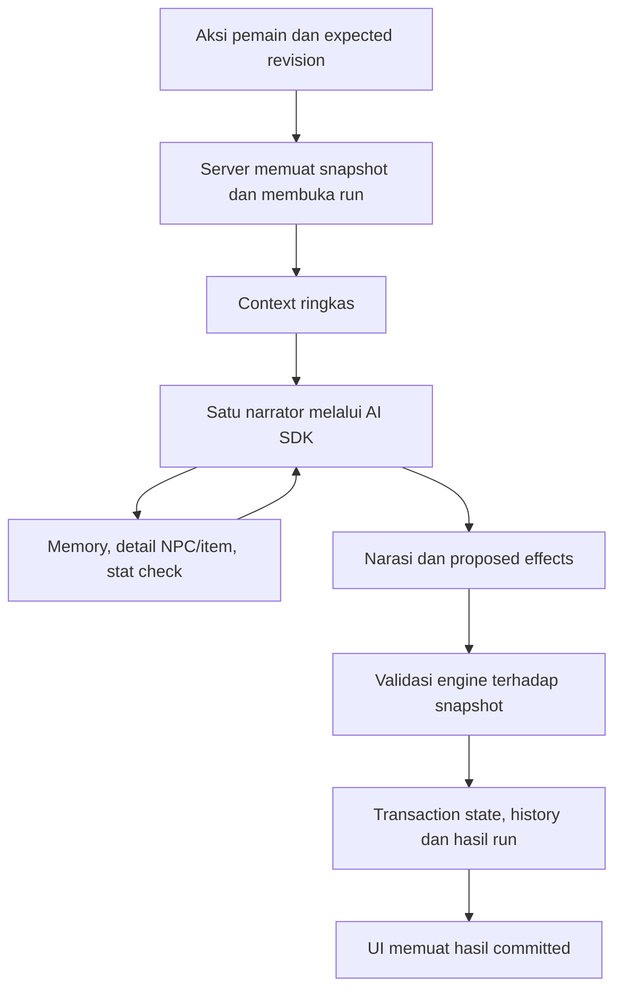

# Implementation Plan — Backend dan AI Agent Fworld

**Tanggal:** 1 Oktober 2026 (Asia/Jakarta).

**Status:** Core code and offline acceptance pass. On the canonical origin with an isolated database, the browser imported and pinned the sample lorebook, created and started a game, opened it with OpenRouter, and traveled to Morroc. IndexedDB transfer/read-back passed for 1 game, 1 session, and 1 message. The 2026-10-12 offline verifier completed 143 HTTP requests with no external fetches. `npm.cmd run doctor` passed with 130/130 tests, client/server typecheck, format, and builds on 2026-10-13. Actor-bound lore is scoped to the selected NPC, except for discoveries already found; undiscovered candidates use per-run opaque handles. The latest Gemini opening failed with `RUN_FAILED` and unknown usage. One verbose OpenRouter travel suggestion and its retry hit output truncation; a concise freeform action succeeded. A/B/C, viewport, disk-failure, and broad recovery acceptance remain open.

**Tujuan:** Memindahkan persistence dan orkestrasi AI ke backend, memakai Vercel AI SDK untuk tool calling, mempertahankan gameplay serta save lama, dan mengukur konsumsi token secara lengkap.

## 1. Scope dan keputusan awal

Rencana ini memakai backend **lokal, satu pengguna, satu proses** sebagai tahap pertama. Frontend tetap React + TypeScript + Vite dengan CSS biasa. Server mengelola game, session, history, credential provider, dan turn; browser mengelola tampilan serta draft editor yang belum disimpan.

Arsitektur ini menggantikan batas browser-only pada bagian terkait PRD/AGENTS. Implementasi dimulai atas permintaan user; status code dan bukti lokal tercatat di §9. Dokumen implementasi UI sebelumnya tetap menjadi catatan historis.

Keputusan:

- Gunakan Vercel AI SDK dengan Gemini API langsung dan OpenRouter. Pilih satu provider/model per run; tidak berpindah provider/model otomatis ketika gagal.
- Gunakan satu agent narrator yang memainkan semua NPC. Engine tetap menghitung check dan memvalidasi seluruh perubahan authoritative state.
- Gunakan SQLite untuk server persistence; IndexedDB menjadi sumber migrasi dan pemulihan legacy, bukan database aktif kedua setelah cutover.
- Mulai dengan context ringkas dan tools untuk data yang panjang atau jarang dibutuhkan. Jangan hanya menambahkan tools di atas prompt penuh sekarang.
- Pertahankan `fworld-template` v1 dan `fworld-save` v1 beserta letak import/export di UI.
- Default tidak menambah login, cloud, sinkronisasi offline, multi-agent, Redis, queue service, ORM, atau vector database.
- Akses tablet/LAN/hosting merupakan tahap lanjutan. Server loopback tahap pertama hanya bisa dipakai dari perangkat server; save pusat sendiri belum berarti aplikasi dapat diakses lintas perangkat.

## 2. Baseline yang sudah diverifikasi

Acuan: [README](README.md), [PRD](prd.md), [rencana UI](implementation_plan.md), dan [manifest](.harness/manifest.json).

| Area         | Implementasi saat penyusunan                                      | Perubahan yang direncanakan                                              |
| ------------ | ----------------------------------------------------------------- | ------------------------------------------------------------------------ |
| UI           | Library, editor, Story/Player/Inventory/People/Facts, Settings    | Pertahankan tampilan dan draft; ganti sumber data ke API                 |
| AI transport | `src/llm.ts`, browser fetch Gemini/OpenRouter                     | Provider SDK dan credential hanya di server                              |
| Turn         | `src/turn.ts`, check, repair, item use, opening, choices          | Orkestrasi server dan native tool calling                                |
| Context      | Konfigurasi/state/facts + 24 pesan terbaru, batas 24.000 karakter | Pemilihan context berdasarkan kebutuhan; history lama lewat retrieval    |
| Engine       | `src/engine.ts`, validasi batch dan check                         | Reuse sebagai kode domain bersama; server melakukan validasi akhir       |
| Persistence  | `src/db.ts`, IndexedDB stores `games`, `sessions`, `messages`     | SQLite dan migrasi semua stores, termasuk draft tanpa session            |
| Concurrency  | Web Locks satu tab dan busy set per session                       | Revision serta idempotency di server; Web Locks hanya selama migrasi     |
| Token usage  | Membaca usage provider, log sebagian total turn                   | Ledger per request, termasuk respons invalid, retry, opening dan choices |

Bukti pada 1 Oktober 2026: `npm.cmd run doctor` lulus, **71/71 tes** dan build frontend berhasil. Runtime terpasang **Node.js 24.13.0**; percobaan database in-memory membuktikan `node:sqlite` dan FTS5 tersedia, SQLite **3.50.4**. `node:sqlite` mengeluarkan experimental warning pada runtime ini; pin runtime dan verifikasi ulang sebelum implementasi storage.

Bukti browser Gemini historis tidak menjadi bukti server SDK baru. Live smoke pada kode saat ini: OpenRouter `google/gemini-3.8-flash` berhasil membuka scene dan mencapai Morroc; latest Gemini opening gagal `RUN_FAILED` dengan usage tidak diketahui. Satu saran travel OpenRouter yang verbose dan retry-nya terpotong pada batas output; aksi bebas yang ringkas berhasil.

## 3. Stack dan pembagian kode

| Bagian              | Pilihan                                                                     |
| ------------------- | --------------------------------------------------------------------------- |
| Runtime backend     | Node.js 24.13+ pada release line yang dipin dan diuji                       |
| HTTP                | `node:http`, routing endpoint eksplisit dalam satu entry point              |
| Database            | `node:sqlite`, prepared statements, transaction singkat, FTS5 untuk history |
| Agent/provider      | `ai` 7.x, `@ai-sdk/google` 4.x, `@openrouter/ai-sdk-provider` 3.x           |
| Schema tools/output | Zod versi kompatibel dengan ketiga paket                                    |
| Frontend            | React + TypeScript + Vite + CSS existing                                    |
| Backend build       | Reuse Vite SSR build; typecheck server terpisah dengan `@types/node`        |
| Pengujian           | `node:test`, assertion existing, SQLite sementara, provider tiruan          |

Snapshot riset paket: `ai` 7.0.126, Google provider 4.0.87, OpenRouter adapter 3.1.0. Periksa kembali kompatibilitas saat memasang dependency, lalu simpan versi konkret dalam lockfile. Tidak perlu mengganti React menjadi Next.js atau memakai Vercel hosting.

Organisasi awal; buat file hanya pada fase yang memakainya:

```text
shared/
  types.ts          domain types dan ProviderId, tanpa import browser/provider runtime
  engine.ts         reuse engine RPG existing
  validation.ts     validator/picker definition, state, bundle dan update existing
  template.ts       parse/export template murni, tanpa IndexedDB
server/
  main.ts           HTTP, endpoint, startup, secret config, serving frontend build
  db.ts             SQLite, transaction, revision, request ledger dan migration receipt
  agent.ts          provider setup, context, tools, output contract dan batas run
  turn.ts           opening/turn/choices/item, idempotency dan commit
src/
  api.ts            fungsi HTTP konkret yang dipakai UI, tanpa repository interface
  db.ts             baca/export legacy IndexedDB untuk migrasi saja setelah cutover
  components/       komponen existing
```

Pisahkan fungsi murni dari `src/db.ts` karena file itu sekarang mengimpor `idb`. `src/types.ts` juga mengimpor `ProviderId` dari `llm.ts`; pindahkan tipe provider ke domain bersama agar server tidak bergantung pada transport browser. Pertahankan semantik validator, parser, rules editor, dan engine; jangan menduplikasinya.

Development: frontend tetap `http://127.0.0.1:5173`, backend `http://127.0.0.1:3001`, Vite meneruskan `/api` ke backend. Production lokal: backend melayani frontend build dan `/api` pada origin canonical 5173 setelah Vite dihentikan. Port yang sibuk menghasilkan error jelas; jangan membunuh proses atau berpindah origin diam-diam.

## 4. Persistence, integritas dan recovery

SQLite menyimpan dokumen definition/state sebagai JSON yang sudah divalidasi. Stats/resources/item definitions tetap data configurable, bukan kolom/tabel per stat atau genre.

| Tabel         | Isi minimum                                                                          |
| ------------- | ------------------------------------------------------------------------------------ |
| `games`       | ID, definition JSON, revision, updatedAt                                             |
| `sessions`    | ID, gameId, definition snapshot, state, AI config, nextSequence, revision, updatedAt |
| `messages`    | Fields existing; unique `(sessionId, sequence)` dan ID                               |
| `turns`       | Session, requestId, input hash, expected revision, status, result/error, timestamps  |
| `ai_requests` | Run/request/attempt, kind, provider/model, usage, status, latency; tanpa prompt/key  |
| `migrations`  | Fingerprint payload tervalidasi, jumlah record, IDs dan receipt sukses               |

Tambah FTS5 index untuk content messages; rebuild index dari messages jika diperlukan. Facts tetap berada dalam canonical session state dan difilter sebelum retrieval. Gunakan foreign keys, parameter binding, dan `PRAGMA user_version` untuk perubahan schema; jangan memasang migration framework.

Aturan write:

1. Semua mutasi session mempunyai expected revision. Start turn, item use, provider switch dan edit definition memakai jalur validasi/revision yang sama.
2. Satu run yang memegang snapshot hanya mengizinkan satu penulis session. Tolak mutasi yang bersaing dengan `409`; edit game yang memperbarui beberapa session menolak jika salah satunya sedang dipakai run.
3. Buat record run dalam transaction singkat, lalu lakukan jaringan di luar transaction. Jangan memegang transaction SQLite selama menunggu model.
4. Tools bekerja terhadap snapshot revision yang sama. Proposed effects disimpan di memory sampai narasi akhir valid.
5. Commit state, snapshot bila relevan, messages, sequence, increment revision, dan status/result turn **dalam satu transaction**. Kegagalan write menggulung seluruh perubahan gameplay.
6. Ledger usage boleh bertahan walaupun gameplay gagal: request AI tetap mungkin menghabiskan token. Jangan menjadikan kegagalan gameplay alasan menghapus usage.

Idempotency menggunakan requestId dari browser yang dipertahankan selama status hasil belum diketahui. RequestId yang sama dengan input sama mengembalikan status/hasil existing; input berbeda menghasilkan `409`. Uniqueness di database dan pemeriksaan revision mencegah commit ganda, bukan hanya tombol disabled.

`POST` turn boleh mengembalikan `202` setelah record run dibuat; satu proses server menjalankan Promise yang ditangani errornya. Browser memeriksa endpoint status hanya selama run aktif. Menutup tab tidak membatalkan run; browser yang dibuka lagi bisa mengambil hasil committed. Tidak perlu worker/queue terpisah untuk versi ini.

Saat restart, tandai run yang masih running sebagai interrupted; jangan memanggil ulang provider otomatis. Bedakan interrupted sebelum commit dari hasil yang sudah committed. Provider mungkin sudah mengenakan biaya ketika respons hilang; status usage demikian adalah unknown, bukan nol. Jaminan yang diberikan adalah commit state sekali, bukan billing provider tepat sekali.

Simpan database di direktori data lokal relatif workspace yang bisa dikonfigurasi, bukan path pribadi hardcoded. Abaikan data/database/backup dan hasil build server dari Git saat implementasi. Backup menggunakan API backup SQLite atau shutdown/checkpoint yang benar; jangan menyalin hanya file `.db` ketika WAL masih aktif. Uji restore backup nyata sebelum cutover.

## 5. Agent, tools dan kontrak hasil



Context wajib memuat aturan engine, scene, identitas/player, NPC aktif, nilai stats/resources relevan, inventory ringkas, hubungan dengan NPC aktif, aksi user, serta percakapan terbaru. Scenario/rules stabil ditempatkan sebelum state yang berubah untuk membantu prefix caching. Deduplicate facts yang sekarang diulang per NPC dan pada daftar global.

Pilih percakapan terbaru berdasarkan budget context, bukan mengirim seluruh history. Jangan memotong state wajib secara diam-diam; jika konfigurasi wajib terlalu besar, tampilkan error yang menjelaskan batas tersebut. Static configuration yang dipadatkan harus tetap mempertahankan aturan, tone, dan karakterisasi penting.

| Tool                                               | Tugas                                                                | Batas                                                                                             |
| -------------------------------------------------- | -------------------------------------------------------------------- | ------------------------------------------------------------------------------------------------- |
| `search_memory(query, npcId?)`                     | Cari history committed dan facts canonical yang relevan              | Maksimal 5 hasil, excerpt total 4.000 karakter; scoped ke session dari server                     |
| `get_npc_details(npcId)`                           | Ambil description/background/goals/knowledge yang tidak dimuat penuh | ID valid pada snapshot; knowledge diberi visibility/knownBy, bukan otomatis pengetahuan semua NPC |
| `get_item_details(itemId)`                         | Ambil definition/effects serta quantity snapshot                     | Item terdefinisi; tidak menambah inventory                                                        |
| `run_check(attributeId, difficulty, mode, npcId?)` | Reuse `validateCheckRequest` dan `runCheck`                          | Maksimal satu check per run; hasil pertama dimemo, pengulangan berbeda ditolak                    |

SessionId, credential, revision dan snapshot diambil dari closure server, bukan argumen yang boleh dipilih model. Jangan menyediakan tools raw SQL, filesystem, HTTP URL bebas, atau mutasi database langsung.

Retrieval awal memakai FTS5 keyword search dengan query yang dinormalisasi, token query dibatasi, dan parameter binding. Telusuri history lama seluruh session, bukan hanya 24 pesan terakhir. Hasil memuat message/fact ID, sequence/waktu, provenance, dan visibility. Kutipan history adalah data cerita, bukan instruksi untuk mengubah aturan agent.

Facts canonical terbaru mengalahkan kutipan historis yang sudah dibantah/dihapus. History yang dibaca narrator tidak otomatis menjadi pengetahuan NPC: tanpa bukti NPC mengetahui kejadian, tandai sebagai narrator context. Ketika `npcId` diberikan, private facts hanya boleh masuk jika NPC itu ada di `knownBy`.

Keyword search belum menjamin pencocokan paraphrase Bahasa Indonesia. Tandai batas ini dengan komentar `ponytail:` pada implementasi retrieval; tambah embeddings hanya jika acceptance recall menunjukkan kebutuhan, bukan sebagai dependency awal. Hasil kosong tidak boleh dianggap bukti suatu kejadian tidak pernah ada, atau alasan mengarang memory.

Final output mengikuti domain existing: narrative, effects, optional world dan choices. Gunakan schema output provider ketika model mendukung; tetap jalankan parser dan engine lokal. Jika kombinasi tools/schema tidak didukung, lakukan finalization dengan tools dimatikan dalam budget yang sama. Model tanpa dukungan native tools ditolak dengan pesan jelas pada konfigurasi backend-agent; jangan diam-diam memakai model/provider lain.

Check result dihitung engine, dilampirkan pada narasi/messages, dan narasi wajib mengikuti outcome. Repair mempertahankan hasil check, provider/model, dan snapshot; jangan melempar randomness kedua. Engine menjaga numeric state; konsistensi makna narasi tetap memerlukan prompt dan acceptance cerita, tidak dijamin schema JSON.

Kontrak upgrade mengganti pilihan wajib dengan nol sampai tiga saran opsional. Opening menghasilkan narasi tanpa perubahan world/effects/check dan menolak opening kedua. Turn boleh mengembalikan daftar kosong; request choices read-only hanya berjalan saat user menekan "Sarankan aksi", bukan saat mount atau setelah item use. Pilihan lama ditolak setelah revision berubah. Penggunaan item tetap menjalankan engine tanpa request LLM.

## 6. Budget AI dan token accounting

Kebijakan awal yang akan diukur, bukan janji performa:

| Batas                     | Nilai awal                                                                                        |
| ------------------------- | ------------------------------------------------------------------------------------------------- |
| Generate requests per run | Maksimal 3, termasuk retrieval follow-up, finalization dan repair                                 |
| Repair                    | Maksimal 1, hanya jika request budget masih tersedia                                              |
| Deadline run AI           | 60 detik total, dibagikan ke setiap request dan tool                                              |
| Output model              | Maksimal 1.200 token pada request awal, 1.800 pada satu repair                                    |
| Tool results              | Maksimal 5 memory hits, 4.000 karakter excerpt; detail entity dibatasi dan diberi flag truncation |
| Target context awal       | Sekitar 1.500–2.500 input token pada fixture representatif; bukan batas token universal           |

AI SDK 7 menyediakan `stopWhen`/`prepareStep`; contoh API saat riset memakai `isStepCount`. Jangan menyalin nama API lama tanpa memeriksa versi terpasang. Jangan mengandalkan default 20 langkah. Counter aplikasi harus mencakup request di luar loop serta retry SDK/provider; nonaktifkan retry transport otomatis yang tidak masuk ledger/budget.

Jika budget habis setelah tool result dan belum ada final output valid, run gagal tanpa commit. Jangan menyimpan tool output sebagai narasi atau menjalankan request keempat untuk memaksakan sukses. Reserve slot final ketika perlu; maksimum langkah bukan jumlah tools dalam satu response.

Ledger per attempt mencatat: run/request ID, kind (`turn`, `opening`, `choices`, `connection_test`), provider/model, input/output/total tokens, cached input, reasoning jika tersedia, latency, finish reason dan status. Tool execution lokal tidak memakai token model; schema, argumen tool dan hasil yang dimasukkan ke request tetap dihitung provider.

Ambil usage **sebelum** parsing/validasi JSON. Simpan usage respons malformed atau engine-rejected, serta retry yang akhirnya gagal. Nilai yang tidak dilaporkan provider disimpan null/unknown; jangan mengisi nol. Beberapa reasoning/cached fields merupakan subset dari total usage: normalisasikan per provider agar tidak dihitung dua kali. Pilihan provider/model tetap sama sepanjang run.

Gunakan usage provider untuk angka aktual; panjang karakter bukan tokenizer universal. Estimasi input sebelum request boleh membantu context selection, tetapi harus diberi label estimasi. Biaya uang memakai tarif input/output/cache model pada tanggal benchmark atau cost yang dilaporkan provider; jangan menyamakan total token dengan tagihan.

### Benchmark konsumsi

Bandingkan tiga konfigurasi pada provider/model dan snapshot yang sama: A = fetch existing dengan context penuh; B = SDK tanpa tools dengan context penuh; C = SDK dengan context ringkas dan tools. B memisahkan efek SDK dari efek perubahan context pada C.

Dataset minimal 20 aksi tetap: dialog biasa, recall kejadian >100 pesan lalu, detail NPC/item, stat check, invalid proposal, refusal/timeout, dan choice generation. Ulangi successful narrative cases tiga kali dengan model settings yang sama. Gunakan salinan database/fixture, tidak menulis save user. Jalankan Gemini langsung dan OpenRouter secara terpisah; jangan membandingkan model berbeda sebagai bukti SDK lebih hemat.

Laporkan total input/output/cached/reasoning per run dan seluruh sesi benchmark, median/p95 latency, request count, repair/failure rate, recall kejadian lama, serta kepatuhan state/knowledge. Include failed attempts dan biaya test/choices; pisahkan usage unavailable dari usage terukur. Jika summary/embedding ditambahkan kemudian, masukkan semua request maintenance dan biaya amortisasinya.

Ilustrasi dari riset, **bukan benchmark nyata**: context penuh 6.000 token, ringkas 1.500, schema tools 300, satu tool call 60, hasil tool 300, narasi 500; abaikan thinking/cache/retry.

| Workflow                                    | Requests | Input total | Output total | Token total |
| ------------------------------------------- | -------- | ----------- | ------------ | ----------- |
| Context penuh tanpa tools                   | 1        | 6.000       | 500          | 6.500       |
| Context ringkas, tools tidak dipanggil      | 1        | 1.800       | 500          | 2.300       |
| Context ringkas, satu retrieval dan narasi  | 2        | 3.960       | 560          | 4.520       |
| Context penuh tetap dikirim, satu retrieval | 2        | 12.960      | 560          | 13.520      |

Target awal C: median input turun minimal 25% dibanding A pada successful matched scenarios tanpa penurunan acceptance cerita/state; input+output total, biaya, failure rate dan latency tetap dilaporkan. Jika target gagal, perbaiki context/retrieval atau revisi desain berdasarkan data; jangan menurunkan kualitas atau menyembunyikan kegagalan untuk mencapai persentase.

## 7. API, credential dan UI

Kelompok endpoint minimum; detail body ditetapkan bersama types domain saat implementasi:

| Kelompok    | Operasi                                                                                     |
| ----------- | ------------------------------------------------------------------------------------------- |
| Health      | `GET /api/health`, versi server/schema, tanpa secrets                                       |
| Games       | List/get/create/update/delete definition; revision dan rules edit existing                  |
| Sessions    | Start/list/get session, paginated messages, AI config update                                |
| Gameplay    | Opening, start turn, status/result by requestId, choices dan item use                       |
| Backup      | Export save v1 tanpa lore atau v2 dengan manifest dependency; import atomik sebagai salinan |
| Migration   | Validasi/transfer legacy stores dan receipt idempotent                                      |
| AI settings | Provider configured flags, model selection, server-side connection test                     |
| Usage       | Ringkasan ledger per session/run, termasuk failed requests                                  |

Gunakan status `400/413` untuk input invalid/terlalu besar, `404` untuk ID tidak ada, `409` untuk revision/busy/idempotency conflict, dan error provider yang dinormalisasi. Payload error berisi code/message/retryable/requestId, tanpa credential/raw provider body. Browser tidak boleh mengirim proposed authoritative state sebagai pengganti aksi.

Input boundary: finite numbers/ranges, enum provider, IDs/references, quantity/sequence, allowlisted nested fields, dan prototype keys seperti validator existing. Batas awal JSON biasa/template 2 MiB, save/migration 32 MiB, aksi pemain 8.000 karakter; request oversized ditolak sebelum menulis data, dengan cara backup/migrasi alternatif yang jelas.

Credential server: `GEMINI_API_KEY` dan `OPENROUTER_API_KEY` melalui environment atau file `.env` yang sudah di-ignore. Reuse pemuatan env bawaan Node; jangan tambah dotenv. Key tidak berada dalam `VITE_*`, bundle frontend, response API, logs, database game, template, save atau backup.

Settings menampilkan configured/not configured per provider, model ID, test connection, dan usage. User dapat memasukkan atau mengganti API key dari Settings; browser mengirim key hanya ke backend loopback, lalu backend menyimpannya di `.env` yang di-ignore dan tidak mengembalikannya. Key tetap di luar database game, log, backup, dan export. Ini bukan secret vault multi-user. Endpoint provider fixed sesuai pilihan, bukan URL bebas. Missing key satu provider tidak memblokir editor atau provider lainnya, tetapi acceptance provider itu tetap pending.

Bind loopback, validasi Host/Origin yang diizinkan pada API, tolak origin asing dan write non-JSON; development proxy mempertahankan pemeriksaan origin. Lindungi static serving dari path traversal dan jangan membuka `.env`/direktori data. UI tetap menampilkan output AI sebagai text/Markdown aman.

UI memuat ulang revision setelah conflict, mempertahankan input Retry, dan menampilkan status backend/turn secara jelas. Saat backend offline, draft in-memory masih bisa diekspor sebagai template; jangan mengklaim draft atau aksi tersimpan. IndexedDB legacy tidak digunakan sebagai fallback writer yang kemudian disinkronkan diam-diam.

## 8. Migrasi save lama dan cutover

Migration berjalan dari browser profile dan origin canonical yang sama. Jangan mengubah nama/version/object stores IndexedDB sebelum export dan verifikasi transfer selesai.

1. Acquire Web Lock existing; baca seluruh `games`, `sessions`, `messages` dalam snapshot readonly, termasuk draft game tanpa session dan semua session satu game.
2. Tampilkan jumlah game/session/messages dan ukuran payload. Sediakan download snapshot migrasi tanpa credential sebelum transfer; format ini untuk recovery semua stores, dibedakan dari template dan save per-session.
3. Server memvalidasi definitions, tiap definition snapshot, runtime state, message references/sequence, relasi game/session, dan revisions. Snapshot session lama tidak harus sama dengan definition game yang telah diedit setelah session dimulai.
4. Gunakan canonical fingerprint untuk retry transfer. Pertahankan IDs pada migrasi awal ketika tidak ada conflict; IDs yang sudah ada dengan content berbeda membatalkan transfer, bukan overwrite otomatis.
5. Masukkan semua records dan migration receipt dalam satu transaction. Payload corrupt/oversized atau write failure tidak meninggalkan partial import.
6. Browser membaca kembali data server dan membandingkan counts, IDs, snapshot/state, serta urutan/content messages. Receipt sukses saja belum menjadi bukti content identik.
7. Setelah verifikasi, cutover UI ke backend dan catat status migrasi. Data IndexedDB lama tetap disimpan; membuka ulang UI tidak mengimpor dua kali.
8. Rollback menggunakan snapshot pre-cutover sebagai recovery point. Export save server terbaru sebelum rollback agar perubahan setelah cutover tidak hilang; jangan merge otomatis dua sumber state yang sudah berbeda.

Migrate/import memakai requestId/fingerprint yang sama selama hasil transfer belum diketahui. Untuk data di origin/profile lain, gunakan export/import manual pada origin lama. Jika full migration melebihi batas, tampilkan error sebelum write dan gunakan transfer per-save/template yang direview; jangan mengabaikan draft atau session secara diam-diam.

Tetap kompatibel dengan `fworld-save` v1 dan `fworld-template` v1. Import save biasa membuat IDs baru seperti behavior sekarang; migrasi legacy merupakan operasi tersendiri yang menjaga hubungan records. Backend-only metadata (revision, ledger, receipt) tidak masuk format JSON publik v1. Setelah restore, revision server baru dimulai dan usage historis yang tidak dibawa save ditampilkan unavailable, bukan nol.

## 9. Fase implementasi dan gate

Checklist mencatat implementasi sampai 12 Oktober 2026. Tes memakai database sementara. Browser memverifikasi alur lorebook hingga travel, serta transfer IndexedDB 1 game, 1 sesi, dan 1 pesan. Gemini terbaru, A/B/C, viewport, disk failure injection, dan recovery menyeluruh masih terbuka.

### Fase 1 — Domain bersama dan pengukuran baseline

- [x] Extract types/engine/validation/template murni; pertahankan behavior dan tes existing.
- [x] Perbaiki usage accounting fetch existing agar semua attempts ikut baseline.
- [ ] Tetapkan fixture benchmark, provider/model/settings, dan baseline A dengan credential yang tersedia.
- [x] Rekonsiliasi PRD/AGENTS dengan scope backend lokal dan tandai rencana UI lama sebagai bukti historis saat implementasi dimulai.

**Bukti lokal:** tipe, engine, validator, dan template dipakai bersama; usage attempts dan malformed-output repair tercakup tes. Benchmark baseline A belum dijalankan.

### Fase 2 — Backend, SQLite dan API data

- [x] Tambah startup/build/typecheck server dengan reuse tooling; health dan proxy origin canonical.
- [x] Implementasi storage games/sessions/messages, constraints, revision dan validator server.
- [x] Implementasi backup/restore, save import/export, rules edit definition dan connection test server.
- [x] Uji recovery interrupted run, revision/sequence conflicts, migration idempotency, dan rollback transaction memakai database sementara.
- [ ] Uji disk/write failure injection dan startup production terhadap profile data user.

Bukti lokal: CRUD/revision dan endpoint API, backup/restore SQLite, save/template, migration rollback/read-back, dan transaksi run tercakup unit/integration tests. Browser menguji alur editor sampai travel; UI migration membaca kembali satu game, satu sesi, dan satu pesan. Disk failure injection masih pending.

### Fase 3 — Agent dan tools terbatas

- [x] Pasang AI SDK/provider versi kompatibel; satu provider/model per run.
- [x] Buat context ringkas, FTS5 retrieval dan tools snapshot dengan schema input.
- [x] Integrasikan check memoized, final output validation dan budget global maksimum 3 requests.
- [x] Nonaktifkan/akun seluruh automatic retries; ledger per request menangkap malformed/error/refusal.

Bukti lokal: mocked agent tests mencakup call budget, repair, check memoization, scope retrieval, model/provider pilihan, failure, dan required-context limit. OpenRouter opening dan travel diuji live. Latest Gemini opening berakhir `RUN_FAILED` dengan usage tidak diketahui.

### Fase 4 — Turn atomik, concurrency dan UI

- [x] Buat run lifecycle/idempotency, status polling, commit revision dan restart recovery.
- [x] Sambungkan library/editor/session/Settings ke `src/api.ts`; pertahankan draft dan navigasi existing.
- [x] Sambungkan opening, Free Chat, Choices dan item use; choices terikat revision dan read-only.
- [x] Cegah edit/provider switch/item use yang bersaing dengan turn; backend offline/error/retry tetap terlihat.

Bukti lokal: run idempotency, stale revision, atomic/read-only commit, interrupted-run recovery, routes, dan backup/restore tercakup tests. Browser memverifikasi create, lorebook import/pin, start, opening, dan satu travel berhasil; browser dua tab dan pemulihan UI setelah close/reopen belum diuji.

### Fase 5 — Migrasi dan cutover

- [x] Transfer seluruh stores dengan Web Lock, fingerprint, validasi dan receipt.
- [x] Verifikasi read-back untuk draft, multi-session, history/check/facts dan IDs.
- [x] Pertahankan IndexedDB serta backup pre-cutover; uji rollback dan export perubahan server.
- [x] Selesaikan restore save/template lama dan pemisahan UI Create Game versus Restore Save.

Bukti lokal: migration transfer tests mencakup preserve IDs, receipt/read-back, retry idempotent, dan rollback conflict; backup dan format v1 tercakup tests. Browser transfer/read-back lulus pada fixture 1 game, 1 sesi, dan 1 pesan; IndexedDB lama tetap utuh.

### Fase 6 — Acceptance nyata dan benchmark

- [ ] Jalankan A/B/C dengan same-model fixtures; laporkan seluruh usage, latency dan kualitas, bukan hanya successful request terakhir.
- [x] Uji Gemini langsung melalui backend: connection test dan satu turn pada revisi sebelumnya memakai database sementara berhasil.
- [ ] Verifikasi ulang turn Gemini pada kode terbaru. Latest opening gagal `RUN_FAILED` setelah satu provider attempt; usage tidak diketahui dan penyebab provider belum tercatat.
- [x] Uji OpenRouter langsung dengan credential server-side. Smoke backend dan browser menguji opening serta travel ke Morroc. Satu aksi saran verbose beserta retry terkena batas output; aksi bebas ringkas berhasil.
- [ ] Uji cerita >100 pesan, recall janji lama, private facts NPC, inventory/resource bounds dan provider switching antar-turn.
- [ ] Ulangi browser acceptance pada 360 px/mobile, tablet/desktop dan zoom; tidak menganggap build sebagai bukti live provider.
- [x] Update README, PRD, manifest dan evidence log sesuai hasil aktual; tandai pending credentials/acceptance secara jujur.

**Gate:** source of truth server, tidak ada partial turn/credential leak, kedua provider menghasilkan gameplay nyata, migrasi/backup/recovery lulus, serta hasil token terukur dan kualitas cerita tercatat.

**Verifikasi lokal 1 Okt 2026:** `npm.cmd run doctor` lulus dengan 100/100 tes, typecheck client/server, format, build frontend dan server. Production smoke pada port sementara 5174 mengembalikan frontend `200` dan `/api/health` `200` (`ok`); data uji dihapus. Port canonical 5173 sedang dipakai server development proyek lain, jadi browser acceptance tidak dijalankan. Gemini connection test dan turn sebelumnya berhasil pada database sementara, tetapi retest kode terbaru gagal sebelum commit setelah dua request provider sukses; OpenRouter belum dikonfigurasi. Node melaporkan `node:sqlite` sebagai experimental.

### Tahap lanjutan — Akses lintas perangkat

Baru dikerjakan ketika user memilih LAN/private tunnel/hosting dan mekanisme aksesnya. Perlu transport HTTPS bila relevan, autentikasi/otorisasi untuk akses remote, batas pemakaian AI, backup server, dan pengujian dua perangkat. Jangan membuka bind publik dari konfigurasi lokal tanpa pekerjaan tersebut. Offline sync, multi-user dan multiplayer tetap perubahan scope terpisah.

## 10. Acceptance utama

- [ ] Create/edit/start/play/choices/item/export/import existing tetap berfungsi pada database server.
- [x] Numeric state, inventory, relationships dan facts hanya berubah setelah engine validation + commit atomik.
- [ ] Retry idempotent, stale revision, multi-tab dan restart tidak menghasilkan double apply atau overwrite.
- [ ] Gemini langsung dan OpenRouter memakai credential yang sesuai; tidak ada fallback lintas provider/model.
- [x] Agent memakai retrieval history/facts terbatas tanpa mengirim seluruh history; cakupan knowledge NPC tetap server-controlled.
- [x] Semua request AI dihitung, termasuk malformed output, failed repair, choices, opening, connection test dan usage unknown.
- [x] Batas 3 requests mencakup seluruh run; item use tidak memanggil model.
- [ ] Semua legacy games/drafts/sessions/messages bermigrasi, read-back identik, dan rollback tersedia melalui browser canonical.
- [x] Template/save v1 tetap kompatibel dan bebas credential/metadata backend yang tidak termasuk formatnya.
- [x] Backend-only mode tidak menulis save baru diam-diam ke IndexedDB ketika server mati.
- [ ] Benchmark membedakan efek SDK, context, tools, cache, reasoning dan model; tidak mengklaim simulasi sebagai hasil live.

Checkbox untuk acceptance live hanya ditutup setelah jalur browser/provider terkait dijalankan; unit tests dan build tidak dianggap sebagai bukti itu.

## 11. Risiko dan batas versi pertama

| Risiko                                                 | Penanganan awal                                                                                                                                           |
| ------------------------------------------------------ | --------------------------------------------------------------------------------------------------------------------------------------------------------- |
| `node:sqlite` experimental pada Node yang diverifikasi | Pin runtime; gate transaction/recovery/backup. Evaluasi driver SQLite stabil hanya jika status/compatibility deployment menuntutnya                       |
| DatabaseSync/FTS5 memblokir event loop pada data besar | Query terindeks, payload/excerpt bounded, pagination. Tandai batas single-process dengan `ponytail:`; worker baru ketika pengukuran menunjukkan kebutuhan |
| Keyword retrieval melewatkan paraphrase                | Uji recall Indonesia dan empty-result behavior; embeddings hanya setelah bukti kebutuhan                                                                  |
| Context lebih pendek mengurangi kualitas NPC/narasi    | Bandingkan fixture kualitas bersama token; pertahankan informasi wajib dan revisi pemilihan context                                                       |
| Tools menambah latency/token                           | Direct narrative jika context cukup, tool result ringkas, budget global dan ledger lengkap                                                                |
| Schema/tools berbeda antar-model                       | Uji masing-masing provider/model; finalization terbatas dalam budget, tanpa silent fallback                                                               |
| Provider sudah mengenakan biaya sebelum crash          | Record request sebelum pengiriman, usage unknown bila hilang; hindari rerun otomatis                                                                      |
| Dua sumber save setelah cutover                        | Server authoritative; IndexedDB legacy readonly; rollback eksplisit dan export perubahan terbaru                                                          |

## 12. Referensi teknis

Referensi dicek saat riset 1 Oktober 2026; API konkret mengikuti versi dependency yang dipin saat implementasi.

- [AI SDK loop control](https://ai-sdk.dev/docs/agents/loop-control): pembatasan langkah dan pemilihan context antar-request.
- [AI SDK tool calling](https://ai-sdk.dev/docs/ai-sdk-core/tools-and-tool-calling): definisi/eksekusi tools dan hasilnya.
- [AI SDK structured data](https://ai-sdk.dev/docs/ai-sdk-core/generating-structured-data): output schema dan validasi.
- [AI SDK Google provider](https://ai-sdk.dev/providers/ai-sdk-providers/google): Gemini langsung dan konfigurasi provider.
- [OpenRouter AI SDK adapter](https://github.com/OpenRouterTeam/ai-sdk-provider): integrasi dan kompatibilitas SDK.
- [Node SQLite](https://nodejs.org/api/sqlite.html): API dan history status stabilitas; cek dokumentasi versi Node terpasang, bukan hanya latest.
- [Gemini token counting](https://ai.google.dev/api/tokens): prompt, system instructions dan function declarations ikut context.
- [Gemini caching](https://ai.google.dev/gemini-api/docs/caching) dan [OpenRouter caching](https://openrouter.ai/docs/guides/best-practices/prompt-caching): diskon biaya bergantung model/provider/cache hit.
